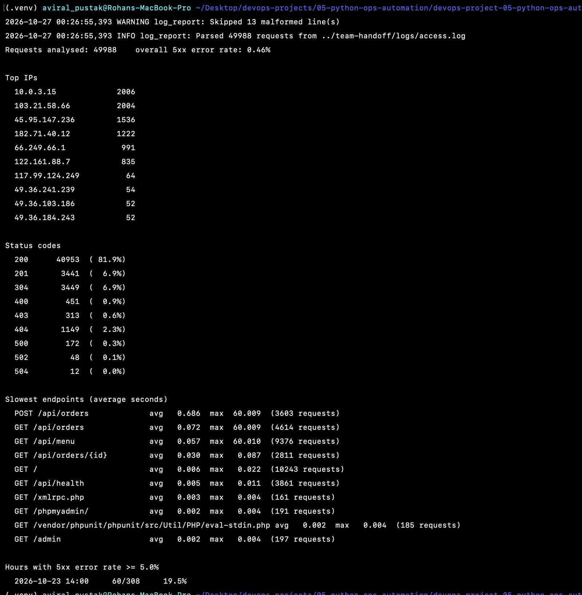
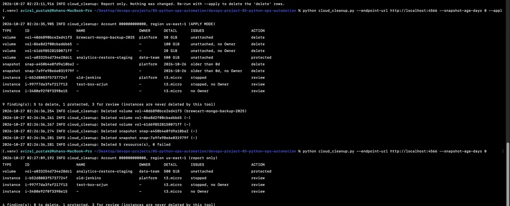
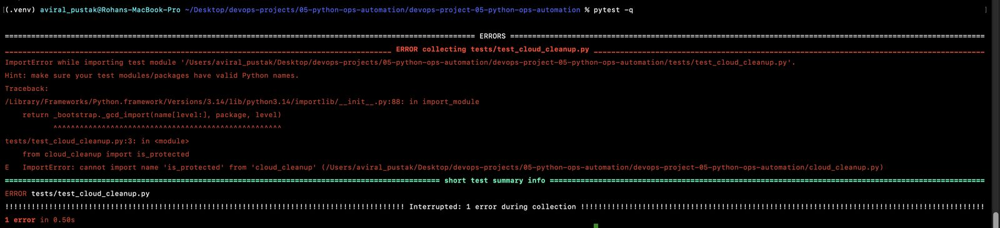

# Project 05: Python Automation for Ops

**Real-World DevOps Projects** · Part 5 of 20 · Rohan Aviral

> **Ticket OPS-105 from Priya (Manager).** Finance says we are paying for things nobody uses. I need a weekly report of unused cloud resources, and a tool that tells us quickly what went wrong in an Nginx log.

Two command-line tools in Python, with arguments, logging, error handling and tests:

| Tool | Answers |
|---|---|
| [`log_report.py`](log_report.py) | Who hit us most? Which status codes? Which endpoints are slow? In which hour did errors spike? |
| [`cloud_cleanup.py`](cloud_cleanup.py) | Which unattached volumes, old snapshots, stopped or untagged instances are we paying for? Deletes **only** with `--apply`, and **never** anything tagged `do-not-delete=true`. |

The AWS side runs against **LocalStack**, a free AWS simulator in Docker, so no real account or money is involved.

📄 Full step-by-step write-up with screenshots: **[Project_05_Python_Ops_Automation.pdf](https://github.com/Aviral-Rohan/devops-project-05-python-ops-automation/releases/download/v1.0.0/Project_05_Python_Ops_Automation.pdf)** (attached to the v1.0.0 release)
🏷️ Release: [v1.0.0: Ops automation tools](https://github.com/Aviral-Rohan/devops-project-05-python-ops-automation/releases/tag/v1.0.0)
⬅️ Previous: [Project 04, Multi-Service Stack with Docker Compose](https://github.com/Aviral-Rohan/devops-project-04-compose-fullstack) · ➡️ Next: Project 06, CI with GitHub Actions

---

## In plain words

- **Reading a log by hand** means scrolling through 50,000 lines. `log_report.py` reads the whole week in about a second and prints the busiest visitors, how many of each result, the slowest pages, and the hours when things broke. Broken lines are counted and skipped instead of crashing it.
- **Finding waste in AWS** means clicking through the console. `cloud_cleanup.py` asks AWS for disks attached to nothing, old backups, stopped servers and servers nobody has claimed. By default it only **reports**. It deletes only when you say `--apply`, only disks and backups (never servers), and never anything its owner has tagged `do-not-delete`.
- **Tests** check the code automatically, so a change that breaks the parser is caught in a second, not by Priya reading a wrong report.

---

## Quick start

```bash
python3 -m venv .venv && source .venv/bin/activate     # Python 3.10+ (developed on 3.14)
pip install -r requirements-dev.txt                     # boto3, pytest (pinned)
pytest -q                                               # 20 passed
```

LocalStack for `cloud_cleanup.py`:

```bash
docker compose -f localstack/docker-compose.yml up -d   # EC2 + STS on http://localhost:4566, seeded with a messy account
export AWS_ACCESS_KEY_ID=test AWS_SECRET_ACCESS_KEY=test # LocalStack accepts any credentials. Never put real keys here.
```

---

## `log_report.py`

```
usage: log_report.py [-h] [--since SINCE] [--until UNTIL] [--top TOP]
                     [--error-threshold ERROR_THRESHOLD] [-v] logfile
```

| Option | Meaning |
|---|---|
| `logfile` | Path to an access log in the `brewcart` format (combined format + `$request_time`) |
| `--since`, `--until` | `"YYYY-MM-DD HH:MM"` in the log's time zone; start included, end excluded |
| `--top N` | How many IPs and endpoints to list (default 10) |
| `--error-threshold P` | List hours whose 5xx rate is ≥ P % (default 5) |
| `-v` | Debug logging, including each skipped line |

Exit codes: `0` report printed · `1` no requests in the window · `2` file missing or unreadable. The report goes to **stdout** and log messages to **stderr**, so `> report.txt` saves a clean report.

### Example: one week of production logs (50,001 lines)

```text
$ python log_report.py ../team-handoff/logs/access.log
WARNING log_report: Skipped 13 malformed line(s)
INFO log_report: Parsed 49988 requests from ../team-handoff/logs/access.log
Requests analysed: 49988    overall 5xx error rate: 0.46%

Top IPs
  10.0.3.15             2006      ← health probe
  103.21.58.66          2004      ← office
  45.95.147.236         1536      ← scanner: /wp-login.php, /.env, /admin ...
  182.71.40.12          1222
  66.249.66.1            991      ← Googlebot
  ...
Slowest endpoints (average seconds)
  POST /api/orders             avg   0.686  max  60.009  (3603 requests)
  GET /api/orders              avg   0.072  max  60.009  (4614 requests)
  GET /api/menu                avg   0.057  max  60.010  (9376 requests)
  ...
Hours with 5xx error rate >= 5.0%
  2026-10-23 14:00     60/308     19.5%
```

### Example: zoom into the incident

```text
$ python log_report.py ../team-handoff/logs/access.log --since "2026-10-23 14:00" --until "2026-10-23 15:00"
Requests analysed: 308    overall 5xx error rate: 19.48%
Status codes
  502         48  ( 15.6%)
  504         12  (  3.9%)
Slowest endpoints (average seconds)
  POST /api/orders             avg  12.223  max  60.009  (20 requests)
```

**What it tells us:** on Thursday 23 Oct between 14:00 and 15:00, 1 in 5 API requests failed with 502/504, and timeouts hit exactly 60 s (the proxy limit). `POST /api/orders` is also the slowest endpoint all week (0.69 s on average, about 10× the others), so that's where Neha should look first.



### Errors are handled, not dumped

```text
$ python log_report.py nope.log; echo "exit code: $?"
ERROR log_report: Log file not found: nope.log
exit code: 2
```

---

## `cloud_cleanup.py`

```
usage: cloud_cleanup.py [-h] [--region REGION] [--endpoint-url ENDPOINT_URL]
                        [--snapshot-age-days N] [--apply] [-v]
```

| What it looks for | Action |
|---|---|
| Volumes in state `available` (attached to nothing) | `delete` |
| Our own snapshots older than `--snapshot-age-days` (default 30) | `delete` |
| Stopped instances | `review` (never deleted by this tool) |
| Instances without an `Owner` tag | `review` |
| **Anything tagged `do-not-delete=true`** (also `TRUE`, `yes`, `1`) | **`protected`**: never deleted, whatever else applies |

Safety rules:

- **Report-only by default.** Nothing changes without `--apply`.
- **Instances are never deleted.** Switching off a server is a human decision.
- **Ownership is double-checked.** The account ID comes from STS, and a snapshot is only considered if its `OwnerId` matches. LocalStack returns hundreds of public AMI snapshots from other accounts even when asked for `self`: never trust a filter blindly.
- **One failed delete doesn't stop the run.** Each delete has its own `try/except`; failures are logged and the exit code is `1`.
- **All pages.** Every `describe_*` call uses a paginator, so large accounts aren't cut off at the first page.

Exit codes: `0` OK · `1` some deletes failed · `2` cannot reach AWS, no credentials, or an API error.

### Example: the weekly report (report-only)

```text
$ python cloud_cleanup.py --endpoint-url http://localhost:4566 --snapshot-age-days 0
INFO cloud_cleanup: Account 000000000000, region us-east-1 (report only)
TYPE      ID                     NAME                        OWNER      DETAIL      ISSUES                     ACTION
volume    vol-40d6890bce2ed41f3  brewcart-mongo-backup-2025  platform   50 GiB      unattached                 delete
volume    vol-86e8d2f00cbad6b65  -                           -          100 GiB     unattached, no Owner       delete
volume    vol-61d698528150071ff  -                           -          20 GiB      unattached, no Owner       delete
volume    vol-a033254d734e28dc1  analytics-restore-staging   data-team  500 GiB     unattached                 protected
snapshot  snap-a450b4e0fd9a10ba2 -                           platform   2026-10-26  older than 0d              delete
snapshot  snap-7a9fe98e6e031979f -                           -          2026-10-26  older than 0d, no Owner    delete
instance  i-b52d8083f5737724f    old-jenkins                 platform   t3.micro    stopped                    review
instance  i-997f7da3fef217f13    test-box-arjun              -          t3.micro    stopped, no Owner          review
instance  i-3480e92f0f3398e15    -                           -          t3.micro    no Owner                   review

9 finding(s): 5 to delete, 1 protected, 3 for review (instances are never deleted by this tool)
INFO cloud_cleanup: Report only. Nothing was changed. Re-run with --apply to delete the 'delete' rows.
```

### Example: `--apply`

```text
$ python cloud_cleanup.py --endpoint-url http://localhost:4566 --snapshot-age-days 0 --apply
INFO cloud_cleanup: Account 000000000000, region us-east-1 (APPLY MODE)
...
INFO cloud_cleanup: Deleted volume vol-40d6890bce2ed41f3 (brewcart-mongo-backup-2025)
INFO cloud_cleanup: Deleted volume vol-86e8d2f00cbad6b65 (-)
INFO cloud_cleanup: Deleted volume vol-61d698528150071ff (-)
INFO cloud_cleanup: Deleted snapshot snap-a450b4e0fd9a10ba2 (-)
INFO cloud_cleanup: Deleted snapshot snap-7a9fe98e6e031979f (-)
INFO cloud_cleanup: Deleted 5 resource(s), 0 failed

$ python cloud_cleanup.py --endpoint-url http://localhost:4566 --snapshot-age-days 0
4 finding(s): 0 to delete, 1 protected, 3 for review
```

The data team's 500 GiB volume is still there.



### Against real AWS

Drop `--endpoint-url`. boto3 then uses your normal AWS credentials (profile, SSO or role). The minimum IAM permissions are `sts:GetCallerIdentity`, `ec2:DescribeVolumes`, `ec2:DescribeSnapshots` and `ec2:DescribeInstances`, plus `ec2:DeleteVolume` and `ec2:DeleteSnapshot` only for whoever runs `--apply`.

---

## The twist: "unattached" is not "unused"

The first version marked every unattached volume `delete`, including **`analytics-restore-staging`** (500 GiB, `Owner=data-team`). Priya stopped it before any `--apply`: the data team attaches that volume once a week to test their database restores.

The fix is a rule owners control: **`do-not-delete=true` overrides everything.** It was built test-first:

1. Wrote `tests/test_cloud_cleanup.py` (6 cases: `true`, `TRUE `, `yes`, `false`, other tags, no tags).
2. `pytest` → **red** (`cannot import name 'is_protected'`).
3. Added `is_protected()` and the override at the end of `build_report()` → **20 passed**.
4. Tagged the volume, ran the report (`protected`), then `--apply`.

The protection check runs **last**, and `apply()` only acts on rows still marked `delete`, so a protected resource can't be deleted by any rule.



---

## Tests

```text
$ pytest -v
collected 20 items
tests/test_cloud_cleanup.py::test_do_not_delete_tag[...]           6 passed
tests/test_log_report.py::test_parses_a_valid_line                 PASSED
tests/test_log_report.py::test_malformed_lines_return_none[...]    4 passed  (cut lines, TLS junk, empty, missing field)
tests/test_log_report.py::test_normalise_path[...]                 4 passed  (/api/orders/42 → /api/orders/{id}, query strings)
tests/test_log_report.py::test_summary_counts_ips_statuses_and_hourly_error_rate   PASSED
tests/test_log_report.py::test_slowest_endpoint_is_first_and_rare_endpoints_are_ignored   PASSED
tests/test_log_report.py::test_time_window_is_start_inclusive_end_exclusive   PASSED
tests/test_log_report.py::test_missing_file_is_handled_cleanly     PASSED
tests/test_log_report.py::test_end_to_end_on_a_small_file          PASSED
20 passed in 0.40s
```

## What's inside

```
devops-project-05-python-ops-automation/
├── log_report.py              # Nginx log analyser
├── cloud_cleanup.py           # unused-EC2 report / cleanup (boto3)
├── tests/
│   ├── test_log_report.py     # 14 tests: parser, paths, summary, window, errors, end-to-end
│   └── test_cloud_cleanup.py  # 6 tests: do-not-delete rule
├── samples/access-sample.log  # first 1,000 lines of the week (the full 9.7 MB log is not in Git)
├── localstack/                # docker-compose.yml + seed script (5 instances, 4 volumes, 2 snapshots)
├── requirements.txt           # boto3==1.43.118
├── requirements-dev.txt       # + pytest==9.1.1
└── pytest.ini                 # pythonpath = . , testpaths = tests
```

## Python or Bash?

| Use Bash when… | Use Python when… |
|---|---|
| It's a one-liner or glues commands together (`awk '{print $1}' \| sort \| uniq -c \| sort -rn`) | You need data structures: averages per endpoint, rates per hour, time windows |
| It runs once | It needs arguments, error handling, logging and **tests** |
| No APIs are involved | You talk to an API (AWS via boto3, HTTP via requests) |

The Bash one-liner and `log_report.py --top 5` give the same top-5 IPs. Everything after that is far easier in Python.

## Problems I hit

| Problem | Cause | Fix |
|---|---|---|
| `zsh: command not found: python` | New terminal tab; venv not activated | `source .venv/bin/activate` in every new tab |
| VS Code "Restricted Mode" | New folder not trusted yet | Trusted the folder (my own code) |
| Deliberate break still showed 14 passed | The edit wasn't saved before running pytest | Learned to check the file is saved; saw red properly in Part 5 |
| New test file never ran | Named `est_cloud_cleanup.py`: pytest only collects `test_*.py` | Renamed; `pytest -v` lists every test it runs |
| `IndentationError: expected an indented block after 'if'` | A pasted line lost one indent level | Re-indented to 12 spaces |
| STS not available | Arjun's LocalStack only enabled EC2 | `SERVICES=ec2,sts` |
| Hundreds of "our" snapshots | The simulator ignores `OwnerIds=["self"]` | Also compare `OwnerId` with the STS account ID |

## What I learned

- Small pure functions (`parse_line`, `normalise_path`, `is_protected`) are easy to test; keep I/O in `main()`.
- `argparse` gives `--help` and input validation for free; `logging` keeps diagnostics on stderr and the report on stdout.
- Exit codes `0/1/2` let cron and CI react without parsing text.
- boto3: use the **client** API, **paginators** for every list call, and `try/except` on `ClientError`, `EndpointConnectionError` and `NoCredentialsError`.
- Destructive tools are report-only by default, act on a narrow set, and respect an owner-controlled `do-not-delete` tag.
- Write the test first and watch it fail; a test that has never failed proves nothing.

## License

MIT. BrewCart and the team members named here are fictional, for training.
